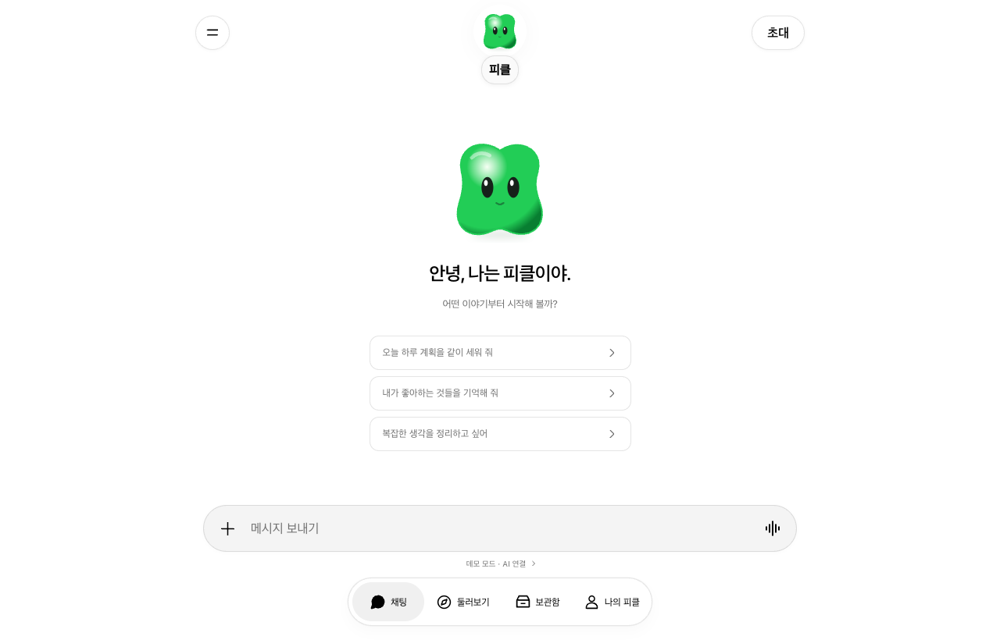

<div align="center">


# Oh-My-Picklebot

**A local-first AI companion that remembers your day.** Talk to your Pickle, keep the memories you choose, set small reminders and collect notes and images in one archive. Everything stays on your computer, and the AI runs on the same machine through Ollama.

One Next.js app, delivered two ways: in your browser, and as an Electron desktop app for macOS, Windows and Linux. No account, no cloud database, no API keys.

[**Website**](https://sungmyeonggi.github.io/Oh-My-Openpickle/) · [**Quick start**](#quick-start) · [**Features**](#features) · [**Architecture**](#architecture) · [**Data and privacy**](#data-and-privacy) · [**Build**](#build-and-release) · [**Roadmap**](#roadmap)

[](https://github.com/SUNGMYEONGGI/Oh-My-Openpickle/actions/workflows/pages.yml)




</div>

> **Alpha, and a personal project.** Oh-My-Picklebot has been tested by hand on macOS (Apple silicon). Windows and Linux builds are configured but not yet verified on real machines. Read [Limitations](#limitations) before relying on it.

> **Inspired by Pickle, not affiliated with it.** The screens and flows follow the Pickle app's published UI declarations, rebuilt from scratch. It never talks to Pickle's servers, uses no Pickle account, and ships none of Pickle's assets: the character and every icon are drawn for this project.

> **The UI is in Korean.** Labels, sample content and the demo replies are written in Korean.

## What it is

A small chat window with four tabs, in the same shape as the phone app it is modelled on:

| Tab | What you do there |
| --- | --- |
| **채팅** (Chat) | Talk to your Pickle. Long-press or open a message's menu to copy it, quote it in a reply, save it to the archive or keep it as a memory. |
| **둘러보기** (Explore) | Browse suggestions in eight areas (money, shopping, health, people and pets, work and paperwork, travel, home, fun). Open one, then start it as a chat draft, or hide it and undo. |
| **보관함** (Archive) | Artifacts and media, grouped by date. Write documents, import TXT/Markdown, import PNG/JPEG/WebP images, export them back. |
| **나의 피클** (My Pickle) | Name and color, theme, AI connection, backup and restore. |

Tap the character in the header for its profile: **한 일 / 예약한 작업 / 함께한 추억** (what it did, scheduled tasks, shared memories). The drawer (☰) holds the main chat, other conversations, search, rename and delete.

## Quick start

Requires Node.js 22.18 or later.

### Web

```sh
git clone https://github.com/SUNGMYEONGGI/Oh-My-Openpickle.git
cd Oh-My-Openpickle
npm ci
npm run dev
```

Open <http://127.0.0.1:3210/app>. The landing page from the Next app is at <http://127.0.0.1:3210/>.

### Desktop

```sh
npm run dist:mac      # dist/mac-arm64/Oh My Picklebot.app
npm run dist:win      # NSIS installer, build on Windows
npm run dist:linux    # AppImage, build on Linux
```

Or run the desktop shell against a fresh build without packaging:

```sh
npm run build
npm run desktop
```

The desktop app starts its own local server on `127.0.0.1:3211` and opens `/app`. Quitting the app stops the server. If the port is taken it shows an error rather than attaching to someone else's server. macOS builds are not signed or notarized; there are no published installers yet.

### Connect a real AI (optional)

The app starts in an explicit **demo mode** that answers with fixed rules, and every demo reply is labelled. For real conversations:

1. Install [Ollama](https://ollama.com) and pull a model, for example `ollama pull llama3.2`.
2. In the app, open **나의 피클 › AI 연결**, press **모델 찾기**, pick the model and switch to **Ollama**.

The app only calls `http://127.0.0.1:11434/api/tags` and `/api/chat`. It never downloads a model on its own, and a failed connection is reported as a failure, never silently replaced by a demo answer.

## Try it

- Send a message, then open its menu and choose **함께한 추억에 기억하기**. Ask about it in the next turn.
- Open the character profile from the header and switch between the three tabs with the arrow keys.
- In **둘러보기**, filter by 여행, open a suggestion, hide it, undo, then start it.
- Schedule a reminder a minute from now and leave the app open.
- Export a backup from **나의 피클**, then restore it in the desktop app.

## Features

- **Chat with context**: the recent turns of the current conversation and the memories you saved are sent to the model. Nothing else.
- **Memories you choose**: add, edit, delete and filter by date or text. The Pickle never saves a memory by itself.
- **Reminders**: one-time or daily, pause and resume, with a run history. They post into the chat **while the app is open**; they do not run tasks or send anything outside.
- **Archive**: date-grouped documents with an editor, TXT/Markdown import and export, PNG/JPEG/WebP import, detail view and download. Imported images stay local and are never sent to the AI.
- **Explore**: eight categories, detail sheets, start, hide and undo.
- **Conversations**: new, search, rename, delete with confirmation, quoted replies.
- **Personalization**: name, color, light/dark/system theme.
- **Voice, where the platform has it**: browser dictation and reading the latest reply aloud. Electron blocks the microphone by default. There are no live voice calls.
- **Backup and restore**: a single JSON file, validated for shape and size before anything is replaced. The current state is exported before a restore.
- **Safe failure**: a change that fails validation or storage is not applied, and your edit stays in place.

## Architecture

```
┌──────────────── Browser  /  Electron window ────────────────┐
│  app/app/page.tsx ── components/PickleApp.tsx               │
│     Chat · Explore · Archive · Profile · CharacterProfile   │
│     state in localStorage "pickle-local-v1" (lib/state.ts)  │
└──────────────────────────────┬──────────────────────────────┘
                               │ fetch /api/chat, /api/models (same origin)
┌──────────────────────────────▼──────────────────────────────┐
│  Next.js server on 127.0.0.1 (3210 web, 3211 desktop)       │
│  app/api/chat ─ demo rules or Ollama (lib/chat.ts)          │
│  app/api/models ─ lists installed Ollama models             │
│  rejects non-loopback hosts and cross-origin requests       │
└──────────────────────────────┬──────────────────────────────┘
                               │ http://127.0.0.1:11434
                          ┌────▼────┐
                          │ Ollama  │
                          └─────────┘
```

| Path | Purpose |
| --- | --- |
| `app/page.tsx`, `components/site/` | Landing page served by the app itself. |
| `app/app/page.tsx` | The app entry. |
| `components/PickleApp.tsx` | Navigation, drawer, persistence, sending, reminders. |
| `components/Chat.tsx` | Messages, menus, composer, voice. |
| `components/WorkspacePanels.tsx` | Archive, Explore, Memories, Tasks. |
| `components/Profile.tsx`, `CharacterProfile.tsx`, `CharacterEditor.tsx` | My Pickle settings and the character profile. |
| `components/Icon.tsx`, `Character.tsx` | The project's own icon set and character. |
| `lib/state.ts` | State schema, limits, parsing and migration. |
| `lib/chat.ts` | Request validation, demo replies, Ollama client, origin checks. |
| `electron/main.cjs` | Starts the bundled server and opens the window; link and permission policy. |
| `site/` | Static website deployed to GitHub Pages. |
| `docs/` | Analysis notes, UI specification and verification records. |

## Data and privacy

| Where | What |
| --- | --- |
| Browser or app `localStorage`, key `pickle-local-v1` | Conversations, memories, reminders, documents, images, settings. |
| Your backup file | The same state as JSON. |

There is no encryption at rest and no sync. Web and desktop keep separate storage; move data with a backup file. Clear browser data only after exporting a backup.

Limits: 100 conversations, 1,000 messages per conversation and 8,000 characters per message, 100 memories totalling 20,000 characters, 100 reminders, 100 documents of up to 50,000 characters. Images: PNG/JPEG/WebP, up to 750 KB and 16 megapixels each. The whole state and backup are capped at 3 MB UTF-8.

The local server binds to `127.0.0.1`, checks the request host and origin, and has no authentication. It is meant for one person on one machine, not for hosting.

## Build and release

```sh
npm run typecheck
npm test            # node --test lib/*.test.ts
npm run build       # Next standalone build + desktop resources
npm run dist:mac    # or dist:win / dist:linux
```

| Item | Value |
| --- | --- |
| App ID | `local.pickle.clone` |
| Product name | Oh My Picklebot |
| Targets | macOS `dir` (arm64), Windows NSIS, Linux AppImage |
| Signing | none |

### Website

`site/` is a static page with no build step. `.github/workflows/pages.yml` publishes it to <https://sungmyeonggi.github.io/Oh-My-Openpickle/> whenever `site/` changes.

```sh
cd site && python3 -m http.server 8765
```

## Limitations

- Verified on macOS Apple silicon only. Windows and Linux are untested.
- No published installers and no auto-update.
- No friends, invitations, 3D world, live calls, payments, connected accounts or background agents. Their entry points say they are not available.
- Reminders fire only while the app is open.
- Native glass materials, spring physics and the 3D character are approximated on the web.

## Roadmap

Planned work for **0.2.0** is tracked in the [v0.2.0 milestone](https://github.com/SUNGMYEONGGI/Oh-My-Openpickle/milestone/1): the remaining design, UI and UX differences from the Pickle desktop app.

## Docs

- [Artifact inventory](docs/artifact-inventory.md) · [Implementation plan](docs/implementation-plan.md) · [UI specification and differences](docs/ui-fidelity-spec.md)
- [Landing design](docs/landing-design.md) · [Icons](docs/icon-attribution.md) · [Verification](docs/verification.md)

## Contributing

- Open an issue before starting substantial work.
- Branch with Git Flow: `feature/*` from `develop` with pull requests back into `develop`; `release/*` and `hotfix/*` merge into `main` and `develop`, and every release on `main` is tagged `v<version>`.
- Keep changes focused and update this README when setup or behavior changes.
- Keep conversation data and personal files out of the repository.
- Run `npm run typecheck` and `npm test` before opening a pull request.

Oh-My-Picklebot is an independent project and is not affiliated with or endorsed by the makers of Pickle.
